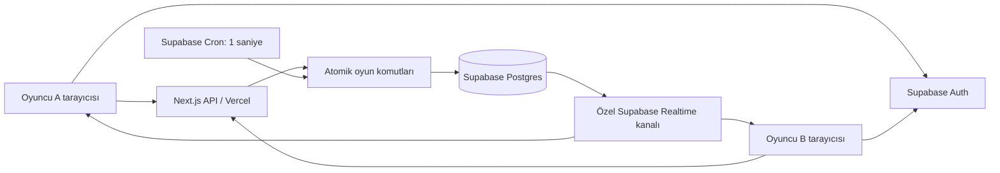

# Debug Duel — Codex Proje Şartnamesi

**Sürüm:** 1.0 · **Tarih:** 2 Kasım 2026 · **Belge dili:** Türkçe · **Hedef:** Gerçek kullanıcıların oynayabildiği, üretime hazır web MVP'si.

Bu dosya ürün tanımı, teknik tasarım ve uygulanabilir geliştirme talimatıdır. Codex, projeyi bu şartnameye göre uçtan uca geliştirmelidir. Yalnızca tasarım demosu, yerel puan hesaplayan bir prototip veya birbirinden bağımsız ekranlar teslim etmek yeterli değildir.

## 1. Ürün fikri ve konuşmadan korunan kararlar

Debug Duel, iki kişinin aynı kısa Python kodundaki mantık hatasını bulmak için gerçek zamanlı yarıştığı bir platformdur. Oyuncu hatalı satırı seçip cevabını gönderir. Sunucu doğrular; ilk geçerli doğru cevap turu kazanır. Üç turun toplam puanı maç sonucunu belirler.

**Marka:** `DEBUG DUEL`  
**Slogan:** `Find the bug. Beat your rival.`

Ürün tek kullanıcı varken de kullanılabilir olmalıdır. Bu nedenle Practice modu ve arkadaş davet bağlantısı MVP'nin temelidir; ürünün çalışması eşzamanlı büyük bir kullanıcı kitlesine bağlı değildir. Kullanıcı ürün sahibi olarak test ve geri bildirim verir; Codex arayüzü, veritabanını, oyun motorunu, testleri ve yayın hazırlığını üstlenir.

| Konuşmadaki karar | Bu şartnamedeki karşılığı |
| --- | --- |
| Next.js, TypeScript, Tailwind CSS | App Router kullanan tek web uygulaması |
| Vercel | Web uygulaması, API ve üretim yayını |
| Supabase | Auth, PostgreSQL, Realtime; zamanlanmış veritabanı işleri |
| İki oyuncu aynı kodu aynı anda görür | Tek sunucu soru seçimi, ortak başlangıç/bitiş zamanları |
| Python Bug Hunt | Hatalı satır seçimi; kullanıcı kodu çalıştırılmaz |
| Arkadaşa bağlantı gönderme | Özel, iki kişilik, süreli davetli oda |
| Üç tur, her tur 45 saniye | Zorunlu MVP oyun formatı |
| Doğru ve hızlı cevap daha çok puan | Bölüm 6'da sabitlenmiş sunucu puan formülü |
| GitHub ve e-posta ile giriş | Supabase Auth; kayıt, doğrulama, çıkış, parola sıfırlama |
| Misafir Practice | Hesapsız deneme; kalıcı XP veya sıralama yok |
| Profil ve ilerleme | Kullanıcı adı, XP, galibiyet, mağlubiyet, beraberlik, doğru cevap sayısı |
| Maç geçmişi ve liderlik tablosu | MVP'nin teslim koşullarına dahil |
| XP ve Rank ayrımı | MVP'de XP var; ELO, lig ve dereceli Rank sonraki sürümde |
| Koyu giriş ekranı | `#10131b`, `#202636`, mor vurgular; tüm ekranlarda aynı tasarım dili |
| Güvenlik ve eşzamanlılık | Özel oda yetkisi, RLS, gizli cevaplar, atomik sonuçlandırma |
| Gerçek ürün | Mobil uyumluluk, hata durumları, testler ve üretim kurulum rehberi |

**Önceki fikirlerin netleştirilmesi:** İlk taslaklardaki misafir 1v1 fikri, hesap sisteminin eklenmesiyle değiştirilmiştir: misafir yalnızca Practice oynar. Önceki 30 saniyelik örnekler yerine 45 saniye kullanılır. Tek soruda biten ilk mimari örneği, üç turluk maçla genişletilir. Liderlik tablosu erken taslakta ertelenebilse de son talebe göre MVP'ye dahildir. Oyuncunun açıklama yazması ve topluluğun soru eklemesi gelecekteki özelliklerdir.

Konuşmadaki giriş önizlemesinin görsel dosyası bu aktarımda bulunmamaktadır. Bu belge, verilen renkleri ve beğenilen koyu terminal estetiğini esas alır; mevcut olmayan bir görselin birebir kopyalandığını varsaymaz.

## 2. Kapsam ve öncelikler

### 2.1 MVP'de zorunlu

- Açılış sayfası; `Play with Friend`, `Quick Practice`, `Leaderboard` ana seçenekleri.
- GitHub OAuth ve e-posta/parola ile hesap oluşturma ve giriş.
- E-posta doğrulama, parola sıfırlama, oturum yenileme ve çıkış.
- Benzersiz kullanıcı adıyla profil tamamlama; kalıcı hesap kimliği olarak UUID.
- Misafir ve kayıtlı kullanıcı için tek kişilik Practice.
- Hesaplı iki oyuncu için oda oluşturma, davet, katılma, hazır olma ve ortak geri sayım.
- Aynı soruların aynı sırayla gösterildiği üç turluk Python Bug Hunt.
- Güvenilir sunucu saati, cevap doğrulaması, tur geçişi ve puanlama.
- Sonuç ekranı, XP, profil istatistikleri, özel maç geçmişi ve XP liderlik tablosu.
- Sayfa yenileme, bağlantı kopması, tekrar bağlanma, çift gönderim ve eşzamanlı cevap yönetimi.
- RLS, özel Realtime kanalları, giriş/oda yetkisi kontrolleri ve gizli soru çözümleri.
- Tekrarlanabilir yerel kurulum, migration, seed, otomatik testler, CI ve Vercel yayın rehberi.

### 2.2 MVP dışında

Rastgele eşleştirme, eşleşme kuyruğu, AI rakip, AI ipucu veya otomatik soru üretimi, ELO/MMR, ligler, sezonlar, JavaScript ve diğer diller, Security Duel, Code Review Battle, kullanıcıların soru göndermesi, serbest açıklama değerlendirme, Python çalıştırma, kod düzenleyip çalıştırma, sesli/yazılı sohbet, seyirci, turnuva, takım maçı, arkadaş listesi, bildirim sistemi, ödeme ve abonelik, yönetim paneli, native mobil uygulama ve açık maç arşivi kapsam dışıdır.

Google girişi konuşmada olası sağlayıcı olarak geçmiştir; MVP'nin zorunlu sağlayıcıları GitHub ve e-postadır. Veritabanı gelecekteki modlara izin vermeli, ancak kullanılmayan modlar için tamamlanmamış ekran ve servisler oluşturulmamalıdır.

### 2.3 Uygulama sırasında seçilen varsayılanlar

Konuşmada sayısal olarak kararlaştırılmayan ayrıntılar bu dosyada açıkça belirlenmiştir: tek cevap hakkı, 3 saniyelik geri sayım, 5 saniyelik tur sonucu, puan/XP formülleri, beraberlik, 15 dakikalık davet süresi ve 30 saniyelik bağlantı toleransı. Bunlar önceki konuşmadan birebir alınmış ayrıntılar değil, uygulamayı belirsiz bırakmamak için seçilen ürün kararlarıdır.

İlk arayüz metinleri, önceki önizlemeyle uyumlu olarak İngilizce olacaktır. Metinleri merkezi bir dosyada tut; Türkçe yerelleştirme daha sonra eklenebilsin. README ve ürün kararları Türkçe yazılabilir. Teknik adlar ve veritabanı alanları İngilizce olmalıdır.

## 3. Kullanıcı türleri ve yetkiler

| İşlem | Misafir | Hesaplı oyuncu | Odanın katılımcısı |
| --- | --- | --- | --- |
| Ana sayfa ve XP liderlik tablosu | Evet | Evet | Evet |
| Practice | Evet | Evet | Evet |
| Kalıcı XP / maç istatistiği | Hayır | Yalnızca doğrulanmış 1v1 sonucu | Kendi sonucuna göre |
| Oda oluşturma | Hayır | Profil tamamlandıysa | Evet |
| Davetle boş koltuğa katılma | Giriş istenir | Geçerli davet varsa | Tekrarda mevcut odaya döner |
| Özel maç durumunu görme | Hayır | Katılımcı değilse hayır | Evet |
| Cevap gönderme | Yalnızca kendi Practice oturumu | Kendi Practice oturumu | Yalnızca kendisi adına |
| Maç geçmişi | Hayır | Yalnızca kendi geçmişi | Dahil olduğu maçın ayrıntıları |
| XP, sonuç, hazır durumu veya rakip cevabı değiştirme | Hayır | Hayır | Yalnızca izin verilen oyun komutları |

Practice için Supabase anonim kullanıcı hesabı açmak gerekmez. Misafir kimliğini uygulamanın ürettiği yüksek entropili, `HttpOnly`, üretimde `Secure`, `SameSite=Lax` çerezle bağla. Sunucuda ham çerez yerine özeti tutulur. Misafir verisi geçicidir; hesap açınca geçmiş XP'ye çevrilmez.

## 4. Teknoloji ve kod organizasyonu

| Alan | Seçim | Uygulama beklentisi |
| --- | --- | --- |
| Uygulama | Next.js App Router + React + TypeScript strict | Sayfalarda Server Components; etkileşimlerde Client Components |
| Stil | Tailwind CSS | Ortak CSS tasarım değişkenleri; koyu tema |
| Kimlik | Supabase Auth, `@supabase/ssr` | Cookie tabanlı SSR; ayrı browser/server istemcileri |
| Veri | Supabase PostgreSQL | Migration, RLS, kısıtlar, transaction ve indeksler |
| Canlı iletişim | Supabase Realtime Broadcast + Presence | Özel maç kanalları; sunucudan doğrulanmış değişiklik bildirimi |
| API | Next.js Route Handlers, Vercel Node.js Functions | Girdi doğrulama, oturum kontrolü, güvenli DTO |
| Oyun motoru | PostgreSQL fonksiyonları | Tek atomik işlem içinde durum, cevap ve skor yönetimi |
| Zamanlayıcı | Supabase Cron / `pg_cron` | Bir saniyelik ortak durum ilerletici; istemciden bağımsız |
| Kod gösterimi | Shiki veya eşdeğer salt okunur syntax highlighter | Satır numarası, seçilebilir satırlar; editör/runtime yok |
| Girdi doğrulama | Zod | API sınırında; DB'de tekrar iş kuralı kontrolü |
| Birim test | Vitest | Kurallar ve dönüşümler |
| DB test | pgTAP veya eşdeğer gerçek Postgres entegrasyon testleri | RLS, transaction, yarış ve idempotency |
| E2E | Playwright | İki ayrı browser context ile gerçek maç |
| Paket yöneticisi | pnpm | Kilit dosyası ve sabitlenmiş sürümler |
| Yayın | GitHub repository + Vercel + Supabase | Ayrı geliştirme/test/üretim yapılandırmaları |

Yeni projede kurulum anındaki desteklenen kararlı sürümleri doğrula, uyumlu tam sürümleri ve Node.js LTS sürümünü sabitle. Bu belge gelecekte de kullanılabileceği için kontrol etmeden bir `latest` bağımlılığına dayanma. Mevcut bir repository varsa sürüm yükseltmesini bu görevin yan işi haline getirme.

Next.js ve Tailwind kurulumunu güncel resmi rehberlere göre yap: [Next.js kurulumu](https://nextjs.org/docs/app/getting-started/installation), [Tailwind + Next.js](https://tailwindcss.com/docs/installation/framework-guides/nextjs). Next.js sürümünün gerektirdiği `proxy.ts` veya `middleware.ts` adını kullan; ikisini çelişkili biçimde birlikte kurma.

Önerilen yapı:

```text
src/
  app/
    (public)/
    (auth)/
    (account)/
    invite/
    match/[matchId]/
    practice/
    auth/
    api/
  components/
    ui/
    auth/
    game/
    profile/
  features/
    auth/
    matches/
    practice/
    leaderboard/
  lib/
    supabase/
    validation/
    game/
    security/
  content/
    copy.en.ts
  types/
    database.generated.ts
supabase/
  migrations/
  seed.sql
  tests/
tests/
  unit/
  integration/
  e2e/
docs/
  architecture.md
  decisions.md
  deployment.md
  test-plan.md
```

## 5. Mimari ve güven sınırları



İki oyuncu birbirine doğrudan bağlanmaz. Aynı `match:<UUID>` özel kanalına abone olur. API komutları veritabanına yazar; transaction ile birlikte yayımlanan küçük durum bildirimleri iki istemciyi güncel sunucu durumunu almaya yönlendirir.

### 5.1 Yetki dağılımı

- **Tarayıcı:** Kod gösterimi, satır seçimi, kullanıcı etkileşimi ve sunucu zamanına göre görsel sayaç. Cevabı, kazananı, süreyi veya XP'yi belirleyemez.
- **API:** Oturumu doğrular; şemayı, Origin'i ve boyutları kontrol eder; doğru RPC'yi çağırır; yalnızca izin verilen alanları döndürür.
- **Veritabanı motoru:** Katılımcı yetkisi, tek cevap hakkı, zaman penceresi, doğruluk, kazanan, tur geçişi, XP ve bütünlük kurallarını uygular.
- **Realtime:** Bildirim ve bağlantı görünümü sağlar. Oyun kararları için veri kaynağı değildir.
- **Cron:** Cevap gelmese veya iki tarayıcı kapansa da süresi dolan durumları ilerletir.

İş kurallarını yalnızca Route Handler içinde bırakma. Tarayıcı doğrudan izinli RPC'ye ulaşsa bile skor veya oyun kuralı atlatamamalıdır. TypeScript hesaplayıcıları test/önizleme içindir; kayıt edilen puanın kaynağı tek veritabanı uygulamasıdır. Sabitlerin uygulama ve DB arasında kaymasını test et.

### 5.2 Kullanıcı ve ayrıcalıklı erişim

Hesaplı oyun komutlarında kullanıcının doğrulanmış JWT'siyle işlem yap; aktör `auth.uid()` üzerinden belirlenir. İstek gövdesindeki `userId`, `winnerId`, `score`, `xp`, `isCorrect`, `submittedAt` gibi alanları kabul etme.

Tarayıcı yalnızca publishable key görür. Misafir Practice yönetimi gibi zorunlu sunucu işleri için ayrı, `server-only` ayrıcalıklı istemci kullan. Supabase secret key veya eski `service_role` anahtarı tarayıcıya, `NEXT_PUBLIC_*` değişkenine, loga veya repository'ye giremez. Ayrıcalıklı istemciye kullanıcı oturumu yükleme; kullanıcı istemcisiyle aynı örneği paylaşma.

SSR oturumunu resmi [Supabase Next.js rehberine](https://supabase.com/docs/guides/auth/server-side/creating-a-client?queryGroups=framework&framework=nextjs) göre kur. Korunan sunucu işlemlerinde doğrulanmamış `getSession()` çıktısını kimlik kanıtı sayma; doğrulanmış claims veya Auth kullanıcı doğrulaması kullan. Kimlik içeren yanıtları ortak CDN önbelleğine koyma.

## 6. Oyun kuralları — kesin MVP davranışı

### 6.1 Maç ve soru formatı

| Kural | Değer |
| --- | --- |
| Oyuncu sayısı | Tam iki farklı hesap |
| Mod | `bug_hunt` |
| Dil | `python` |
| Tur sayısı | 3; normal maçta skor farkına bakılmaksızın üçü de oynanır |
| Tur sırası | Bir kolay, bir orta, bir zor soru |
| Tur süresi | En fazla 45.000 ms |
| İlk geri sayım | 3 saniye |
| Turlar arası | 15 saniye tur sonucu, ardından 3 saniye geri sayım; Explanation/Previous rounds maç sonunda (4 Kasım 2026 kullanıcı kararı) |
| Cevap | 1 tabanlı hatalı satır numarası |
| Cevap hakkı | Oyuncu başına turda bir geçerli gönderim |
| Tur bitişi | İlk doğru cevap, iki yanlış cevap veya süre bitimi |
| Maç sonucu | Toplam puanı yüksek oyuncu kazanır; eşitse beraberlik |

Her soru tek, açıkça tanımlanmış bir mantık hatası ve tek doğru satır içermelidir. Salt okunur kod, kısa görev tanımı ve beklenen davranış gösterilir. Satır seçimi göndermeden değiştirilebilir; gönderimden sonra geri alınamaz. Yanlış cevap oyuncunun hakkını bitirir, rakibin kalan hakkı devam eder.

İlk doğru cevap kabul edildiğinde tur hemen kapanır. İki oyuncunun doğru gönderimi aynı anda gelirse transaction kilidini alıp zaman/yetki kontrolünden geçen ilk işlem kazanır. Diğerine turun kapandığı bildirilir; ikinci kazanan veya ikinci tur puanı oluşmaz. Bu sıralama sunucunun kabul sırasıdır; ağ gecikmesini ortadan kaldırdığı veya fiziksel tıklama sırasını ölçtüğü iddia edilmez.

### 6.2 Tur puanı

Kazananın puanı, aynı transaction içinde alınan veritabanı zamanından hesaplanır:

```text
elapsed_ms = floor((accepted_at - starts_at) milliseconds)
remaining_ms = clamp(45_000 - elapsed_ms, 0, 45_000)
speed_bonus = floor(50 * remaining_ms / 45_000)
round_points = 100 + speed_bonus
```

Yanlış cevap, süre aşımı veya rakibin önce doğru bilmesi: **0 puan**. Bir tur en fazla 150, bir maç en fazla 450 puandır. Eksi puan yoktur. Hız bonusu, önce doğru cevap veren oyuncular arasında hızlı çözmeyi ödüllendirir.

| Kabul edilen doğru cevabın süresi | Tur puanı |
| --- | --- |
| 0 ms | 150 |
| 9.000 ms | 140 |
| 22.500 ms | 125 |
| 44.999 ms | 100 |
| 45.000 ms ve sonrası | Kabul edilmez; 0 |

Kabul aralığı `starts_at <= accepted_at < ends_at` olmalıdır. Başlamadan gönderilen cevap reddedilir. Zaman damgası satır kilidi alındıktan sonra `clock_timestamp()` ile alınır; kilit beklemeden önceki transaction başlangıç zamanına güvenilmez. Bu fark [PostgreSQL zaman fonksiyonlarında](https://www.postgresql.org/docs/current/functions-datetime.html) açıklanır.

### 6.3 Beraberlik ve kayıt edilen istatistikler

Üç tur sonunda toplamlar eşitse maç `draw` olur; gizli ek tur, rastgele kazanan veya tarayıcı zamanına göre eşitlik bozma yoktur. Hiç kimse doğru cevap vermezse 0–0 beraberlik mümkündür. İstatistikler `wins`, `losses`, `draws`, `matches_played`, `correct_answers` olarak ayrı tutulur.

`correct_answers`, kabul edilen ve turu kazandıran doğru cevapların toplamıdır. Maçta puan ile XP ayrı kavramlardır. XP deneyim puanıdır; beceri derecesi veya ELO değildir.

### 6.4 XP kuralları

Normal tamamlanan maçta, en az bir geçerli cevap gönderen oyuncu için:

```text
xp_earned = 20 + (10 * rounds_won) + outcome_bonus
outcome_bonus = 30 if win, 15 if draw, 0 if loss
```

Hiç cevap göndermeyen oyuncu 0 XP alır. Practice, iptal edilen veya altyapı nedeniyle geçersiz sayılan maç 0 XP verir. XP azalmaz. Sonuç ekranında maç puanı, kazanılan XP ve yeni toplam XP ayrı gösterilir.

Bağlantı terkinde/teslim olmada terk eden 0 XP alır. Diğer oyuncu en az bir kapanmış turda geçerli cevap göndermişse `30 + 10 * rounds_won`, aksi halde 0 XP alır. Galibiyet/mağlubiyet yine kayıt edilir. Böylece açılışta hemen terk edilen oda doğrudan XP üretmez.

Basit tekrar ödülü sınırı: Aynı iki hesabın bir UTC günündeki ilk **5** sonuçlanmış maçı XP için uygundur; sonraki maçlar oynanır ve geçmişe yazılır, XP 0 olur. Normal bitiş ve forfeit bu kotayı tüketir; abort/iptal tüketmez. Kontrol sıralanmış kullanıcı çifti ve UTC gününe ait transaction kilidi altında yapılır. UI sınır dolduğunda nedenini açıklar. Bu sınırlama çoklu hesapla anlaşmalı oynamayı bütünüyle çözmez; MVP liderlik tablosu rekabetçi beceri sıralaması olarak tanıtılmamalıdır.

### 6.5 Oda ve davet

1. Profilini tamamlamış kullanıcı oda oluşturur; sunucu host koltuğunu ayırır.
2. Sunucu CSPRNG ile en az 32 byte rastgele davet token'ı üretir; kalıcı davet tablosuna yalnızca SHA-256 özeti yazılır. Kaybolan oluşturma yanıtını güvenle tekrar döndürmek için komut receipt'inde, davet süresini aşmayan şifreli yanıt kopyası tutulabilir; düz metin token saklanmaz.
3. Paylaşılabilir bağlantı `/invite/<token>` biçimindedir; oda UUID'si tek başına katılım izni sağlamaz.
4. Davet, oluşturulmasından itibaren 15 dakika ve tek rakip koltuğu için geçerlidir.
5. Bağlantının açılması maça katılmak değildir. Giriş ve açık `Join Match` işlemi gerekir; link önizleme botları koltuğu tüketemez.
6. Misafir giriş yapar; güvenli dönüş akışı daveti korur. Auth sonrasında aynı davete dönülür.
7. Katılma transaction'ı odayı kilitler; boşluk, token, süre, farklı hesap ve aktif maç kısıtını birlikte denetler.
8. Aynı kullanıcı yeniden katılmayı denerse mevcut koltuğuna döner. Üçüncü kişi alınmaz.
9. İki oyuncu hazır olmadan maç başlamaz. Son hazır işlemi iki hesabın da son 15 saniyede heartbeat gönderdiğini doğrular ve tek sefer ortak başlangıç planlar. Eski bağlantının hazır bayrağı sıfırlanır; diğer oyuncuya bekleme nedeni gösterilir.
10. Bir kullanıcı aynı anda yalnızca bir aktif 1v1 odada bulunabilir.

Host kendi davetinden ikinci oyuncu olamaz. Ham davet token'ı oluşturma yanıtında gösterilir; yenilemeden sonra saklanmamışsa host başlamamış oda için yeni davet üretebilir. Yeni token eskisini geçersiz kılar. Rakip katıldıktan sonra davet döndürme ve koltuk değiştirme yoktur.

### 6.6 Ayrılma, bağlantı kopması ve yenileme

| Durum | Sunucu davranışı | Arayüz |
| --- | --- | --- |
| Bekleme odasında rakip ayrılır | Rakip koltuğu boşalır; iki hazır bayrağı sıfırlanır | Yeni davet üretilebilir |
| Bekleme odasında host ayrılır | Oda iptal edilir; aktif koltuklar serbest kalır | Rakibe oda kapandı mesajı |
| Bekleme 15 dakikayı aşar | Oda `expired`; XP/istatistik yok | Yeni oda oluşturma seçeneği |
| Maç sırasında sayfa yenileme | Aynı hesap, aynı koltuk, mevcut sunucu durumu | Sayaç ve gönderilmiş cevap geri yüklenir |
| Kısa ağ kesintisi | Oyun saati devam eder; hak veya süre sıfırlanmaz | `Reconnecting…` |
| Tek oyuncunun kalp atışı 30 saniyedir yok, rakibi son 15 saniyede aktif | Bağlantısı kesilen kaybeder; `forfeit` | Açık sonuç nedeni |
| İki oyuncunun da kalp atışı en az 30 saniyedir yok | Maç `aborted`; XP/win/loss/draw yok | Sonradan dönülünce iptal nedeni |
| Oyuncu maç içinde `Leave Match` onaylar | Anında forfeit | Karardan önce açık açıklama |
| Aynı hesap ikinci sekmeyi açar | Yeni koltuk yok; cevap hakkı DB'de ortak | İkinci gönderim sonuç değiştirmez |

Kalp atışı her 5 saniyede kimliği doğrulanmış API üzerinden gönderilir; zamanını DB yazar. Presence verisi bağlantı göstergesidir, forfeit kanıtı değildir. Rakibin Presence mesajıyla başka oyuncuyu çevrimdışı göstermesi sonuç doğurmamalıdır.

Bir geri dönüş/heartbeat isteği önce mevcut zamanla geçmiş eşikleri değerlendirir; 30 saniyelik kaybı kesinleşmiş oyuncu sonradan heartbeat gönderip sonucu geri alamaz. Süresi dolan tur ve üçüncü turdaki normal bitiş, aynı işlemde bağlantı kaybı değerlendirmesinden önce ele alınır.

Altyapının tamamında kesinti yaşanması oyuncu terkine eşit sayılmaz. Zamanlayıcı/DB kesintisi tespit edilmiş maçlar `infrastructure_interruption` nedeni ile abort edilir; otomatik galibiyet ve XP verilmez. Kesinti algısı için motor sağlık kaydı kullan; davranışı entegrasyon testinde doğrula.

## 7. Oyun durum makinesi ve zamanlayıcı

### 7.1 Maç ve tur durumları

```text
waiting -> countdown -> playing -> between_rounds -> countdown -> playing
playing (round 3 resolves) -> finished
countdown / playing / between_rounds -> finished (forfeit)
waiting -> cancelled / expired
countdown / playing / between_rounds -> aborted

round: pending -> active -> resolved
```

Maç `finished` olduğunda sonuç türü `win`, `draw` veya `forfeit` olur. `cancelled`, `expired`, `aborted` terminal durumları puan/istatistik ödülü üretmez. Terminal durumdan aktif oyuna geçiş yoktur. Yeniden oynama yeni maç kimliği gerektirir.

Üç tur kaydı maç başında oluşturulur; sorular sunucuda bir kez seçilir. İlk tur başlangıcı son hazır işlemi sırasında `db_now + 3 seconds` olur. Diğer turların başlangıcı önceki turun kapanması sırasında `db_now + 8 seconds` olarak planlanır. Kod hiçbir tur için başlangıçtan önce gönderilmez. Üçüncü tur kapanınca sonuçlar ve XP aynı transaction içinde kesinleştirilir.

### 7.2 Süreyi güvenilir biçimde ilerletme

Süreleri Vercel Function içindeki `setTimeout`, bellek içi sayaç, yalnızca istemci interval'i veya açık bırakılan bir HTTP isteği ile yönetme. DB'de `starts_at`, `ends_at`, `resolved_at`, `next_transition_at` tut.

Supabase Cron, `private.advance_due_matches()` fonksiyonunu bir saniyede bir çalıştırır. Tek ortak iş, zamanı gelen sınırlı sayıda maçı `FOR UPDATE SKIP LOCKED` ile alır. İşlem sayısı ve çalışma süresi sınırlıdır; internet çağrısı yapmadan yerel DB fonksiyonları çalıştırılır. Aynı durum ilerletici, doğrulanmış kullanıcı komutlarından da çağrılabilir; ödül ve tur geçişi her yolda idempotenttir.

Örnek zamanlama sözleşmesi; gerçek migration öncesi kurulu extension desteği doğrulanmalıdır:

```sql
select cron.schedule(
  'debug-duel-advance-matches',
  '1 second',
  $$select private.advance_due_matches();$$
);
```

Supabase Cron saniyelik işleri destekler; gereksinimler ve iş geçmişi yönetimi için [Cron](https://supabase.com/docs/guides/cron) ve [quickstart](https://supabase.com/docs/guides/cron/quickstart) kaynaklarını kullan. Bir saniyelik işin logları hızla büyüyebileceği için günlük temizleme ile son 7 günlük çalışma kaydı korunur. Production Cron kurulmadan gerçek zamanlı MVP tamamlanmış sayılmaz.

`GET state` salt okuma yapar. İstemcinin zaman eşiğinde çağırdığı `POST sync` ortak ilerleticiyi tetikler; istemci gelecek bir zamanı gönderemez veya turu erken kapatamaz. Cron çalışırken iki istemci de kapatılırsa maçın yine doğru sonuçlanmasını bekleyen test, yalnızca tarayıcıdan ilerleyen yanlış zamanlayıcı mimarisini yakalamalıdır.

`next_transition_at`, o anda beklenen tur başlangıcı/bitişi, lobi son kullanma zamanı ve bağlantı toleransı eşiklerinden en erken olanıdır. Her ready/heartbeat/geçiş komutu bu değeri yeniden hesaplar; böylece 30 saniyelik forfeit kontrolü 45 saniyelik tur sonuna kadar beklemez. Cron boş iş yükünde de sağlık kaydını günceller; bir maçtaki hata diğer maçların işlenmesini kalıcı olarak durdurmaz.

Zamanlayıcı gecikmesi tur süresini uzatmaz: bitiş anından sonraki cevap her durumda reddedilir. Motor normal çalışırken görsel sonuç geçişi gecikmesinin hedefi en fazla 2 saniyedir. Sunucu zamanı `serverNow` ile döner; istemci gidiş-dönüş süresinin orta noktasına göre farkı tahmin eder, ekranda `performance.now()` ile akıcı gösterim yapar. Bu tahmin cevap kabulünü etkilemez.

Motor sağlık kaydında son başarılı tick bulunur. Sağlık 5 saniyeden uzun süredir güncellenmiyorsa yeni maç başlangıcı durdurulur. Tick arası 10 saniyeyi aşan altyapı boşluğunda devam eden maçlar önce güvenli biçimde abort edilir; geçmiş pencere için forfeit veya geriye dönük yeni tur üretilmez. Yerel geliştirme ve testte aynı eşikler kontrollü saatle sınanır.

## 8. Veritabanı şeması

Bu bölüm migration'ın sözleşmesidir; tablolar, indeksler, GRANT ve RLS birlikte uygulanmalıdır. Aşağıdaki sütun listeleri doğrudan çalıştırılabilir tam SQL migration değildir. Codex, kurulu Supabase/Postgres sürümüne uygun migration'ları üretmeli ve sıfırdan kurulumla doğrulamalıdır.

### 8.1 Genel kurallar

- Kimlikler UUID; zamanlar `timestamptz`, DB kayıtları UTC; gösterim kullanıcının yerel saatine göre.
- `created_at` ve `updated_at` sunucu tarafından yazılır.
- Açık API şemasındaki her tablo için RLS açılır; ayrı tablo izinleri de daraltılır.
- Cevap, çözüm ve davet özeti `private` şemadadır; bu şema Data API'ye açılmaz.
- Soru güncellemek yeni versiyon oluşturur. Başlamış maçın kodu, doğru satırı ve açıklaması değiştirilemez.
- E-posta, parola, provider token'ı veya gereksiz OAuth metadata'sı profil tablosuna kopyalanmaz.

### 8.2 `public.profiles`

| Alan | Tip / kural |
| --- | --- |
| `id` | UUID PK, `auth.users.id` FK; değişmez hesap kimliği |
| `username` | Nullable text; onboarding sonunda 3–20 ASCII harf/rakam/alt çizgi; küçük-büyük harf duyarsız unique |
| `display_name` | Text, en fazla 40 karakter; düz metin |
| `avatar_seed` | Text; uygulamanın yerel ürettiği avatar için, rastgele dış URL değil |
| `onboarding_completed_at` | Nullable timestamptz |
| `xp` | Bigint, default 0, `>= 0` |
| `wins`, `losses`, `draws`, `matches_played`, `correct_answers` | Nonnegative integer, default 0 |
| `created_at`, `updated_at` | Timestamptz |

Unique indeks: `lower(username)` yalnızca username doluysa. `matches_played = wins + losses + draws` tutarlılığı korunur. Profil ilk doğrulanmış hesap açılışında idempotent oluşturulur. OAuth adı güvenli bir öneridir; otomatik yetki veya benzersizlik garantisi değildir. İstemci XP ve istatistik sütunlarına UPDATE yapamaz.

### 8.3 `public.matches`

| Alan | Tip / kural |
| --- | --- |
| `id` | UUID PK |
| `host_user_id` | UUID FK profiles; zorunlu |
| `guest_user_id` | Nullable UUID FK profiles; host ile farklı |
| `mode`, `language` | MVP için `bug_hunt`, `python` |
| `status` | `waiting`, `countdown`, `playing`, `between_rounds`, `finished`, `cancelled`, `expired`, `aborted` |
| `round_count`, `round_duration_ms` | Sabit 3 ve 45000 |
| `current_round_number` | Smallint, 0–3 |
| `state_version` | Bigint, her anlamlı oyun değişiminde monoton artar |
| `outcome_type` | Nullable `win`, `draw`, `forfeit` |
| `winner_user_id` | Nullable UUID; doluysa maçtaki iki oyuncudan biri |
| `ended_reason` | Nullable kontrollü neden kodu |
| `lobby_expires_at`, `next_transition_at` | Timestamptz; sonraki geçiş yoksa ikincisi null |
| `started_at`, `finished_at` | Nullable timestamptz |
| `created_at`, `updated_at` | Timestamptz |

`draw` kazanan içermez. `win` ve `forfeit` tek kazanan içerir. İptal/abort/expiry sonucu kazanan içermez. Durum/sonuç bileşimlerini CHECK ve engine kontrolleriyle doğrula. Host ve guest alanları, RLS'nin üyelik tablosuyla karşılıklı sonsuz sorguya girmeden yetkiyi belirlemesini sağlar.

### 8.4 `public.match_players`

| Alan | Tip / kural |
| --- | --- |
| `match_id`, `user_id` | Composite PK; matches ve profiles FK |
| `slot` | Smallint 1 veya 2; unique `(match_id, slot)` |
| `ready_at` | Nullable timestamptz |
| `joined_at`, `last_seen_at` | Timestamptz; DB yazar |
| `is_active` | Boolean; aktif oda/maç boyunca true |
| `total_score`, `rounds_won`, `correct_answers` | Integer, nonnegative |
| `result` | Nullable `win`, `loss`, `draw`, `aborted` |
| `xp_earned` | Integer, default 0 |
| `username_snapshot` | Maç başladığında görünen ad; geçmiş için |

Partial unique indeks: `user_id WHERE is_active = true`. Bu indeks iki eşzamanlı oda oluşturma/katılma isteğinde de tek aktif maç kuralını korur. Terminal durumda iki aktif bayrak aynı transaction içinde kapanır. Bekleme odasından ayrılan guest kaydı kaldırılabilir; başlamış maçın katılımcı kimliği değiştirilemez. Koltukların `matches.host_user_id/guest_user_id` ile eşleşmesi engine ve bütünlük testleriyle korunur.

### 8.5 `public.match_rounds`

| Alan | Tip / kural |
| --- | --- |
| `id` | UUID PK |
| `match_id`, `round_number` | FK + smallint 1–3; unique birlikte |
| `status` | `pending`, `active`, `resolved` |
| `starts_at`, `ends_at` | Nullable timestamptz; planlandığında tam 45 saniye fark |
| `resolved_at` | Nullable timestamptz |
| `winner_user_id` | Nullable UUID; yalnızca maç katılımcısı |
| `end_reason` | Nullable `correct_answer`, `both_incorrect`, `timeout`, `match_ended` |
| `winning_points` | Integer 0–150 |

Bu tablo doğru satırı, açıklamayı, gelecek sorunun kimliğini veya kodunu içermez. Henüz başlamamış soruyu doğrudan tablo sorgusuyla öğrenmek mümkün olmamalıdır. Bir tur en fazla bir kazanan üretir. Forfeit/abort anında kalan turlar `match_ended` ile kapanır ve puan vermez.

### 8.6 `private.questions`

Alanlar: `id UUID PK`, `slug text`, `version integer`, `pool ('duel'|'practice')`, `language`, `difficulty ('easy'|'medium'|'hard')`, `title`, `prompt`, `code`, `line_count`, `correct_line`, `explanation`, `corrected_code`, `tags text[]`, `is_active`, `created_at`.

`unique(slug, version)`, `1 <= correct_line <= line_count`; satır sayısı normalleştirilmiş koddan doğrulanır. Bütün alanlar server-only'dir. İstemci soru seçemez veya katalog çözümlerini listeleyemez. Soru içeriği üretim client bundle'ına import edilmez.

### 8.7 `private.round_questions`

Alanlar: `round_id UUID PK/FK`, `question_id UUID FK`, `question_version`, `title_snapshot`, `prompt_snapshot`, `code_snapshot`, `line_count`, `correct_line`, `explanation_snapshot`, `corrected_code_snapshot`.

Maça seçilen içerik ve çözümün değişmez kopyasıdır. Aynı maçta soru tekrarını engine engeller. Sunucu, mevcut tur başlamışsa yalnızca güvenli soru alanlarını; başlamış ve çözülmüş tur için ayrıca çözüm alanlarını DTO'ya ekler. Başlamadan `match_ended` ile kapanan tur çözümü açılmaz. Gelecek turların içeriği ve açıklaması hiçbir yoldan açılmaz.

### 8.8 `private.answers`

Alanlar: `id UUID PK`, `round_id UUID FK`, `match_id UUID FK`, `user_id UUID FK`, `selected_line integer`, `accepted_at timestamptz`, `elapsed_ms integer`, `is_correct boolean`, `awarded_points integer`, `idempotency_key UUID`, `request_hash text`.

Kısıtlar: unique `(round_id, user_id)`; unique `(user_id, idempotency_key)`; gönderilen satır kod aralığında olmalı. `match_id` ile turun gerçek maçı composite FK veya eşdeğer kontrolle tutarlı kalmalıdır. Aynı idempotency key farklı gövdeyle kullanılırsa `409 IDEMPOTENCY_CONFLICT` döner. Giriş/süre/aralık kontrolünde reddedilen istek cevap hakkını tüketmez. Kabul edilen yanlış cevap hakkı tüketir.

### 8.9 Ödül ve işlemsel kayıtlar

| Tablo | Alanlar ve amaç |
| --- | --- |
| `private.match_settlements` | `match_id PK/FK`, `settled_at`, `outcome_type`, `reward_eligible`, `reward_day`; istatistik/XP kesinleştirmesi için tek kayıt |
| `private.xp_ledger` | `id`, `match_id`, `user_id`, `amount`, `reason`, `created_at`; unique `(match_id, user_id)`; profil XP artışının denetlenebilir kaynağı |
| `private.match_invites` | `match_id PK/FK`, `token_hash unique`, `expires_at`, `consumed_by`, `consumed_at`, `rotated_at`; ham token yok |
| `private.command_receipts` | `user_id`, `command_name`, `idempotency_key`, `request_hash`, `safe_response`, `sensitive_response_ciphertext nullable`, `ciphertext_expires_at nullable`, `created_at`; unique ilk üç alan; create/join/ready/leave gibi komut tekrarları |
| `private.rate_limits` | `subject_hash`, `action`, `window_start`, `request_count`; atomik ve kalıcı hız sınırı sayacı |
| `private.engine_health` | Tek satır; `last_successful_tick_at`, `last_gap_at`; zamanlayıcı sağlığı |

`match_settlements` ekleme, oyuncu sonuçları, profil istatistikleri ve XP ledger ekleme tek transaction'dır. Unique çakışmasında kısmi ödül yapılmaz; mevcut kesin sonuç döner. `profiles.xp`, ilgili ledger toplamıyla tutarlı olmalıdır. Aynı rakip günlük kotası settlement kayıtlarından transaction kilidi altında hesaplanır.

### 8.10 `private.practice_sessions`

Alanlar: `id UUID PK`, `guest_subject_hash nullable`, `user_id nullable`, `question_id`, soru/çözüm snapshot alanları, `status ('active'|'resolved'|'expired')`, `starts_at`, `ends_at`, `selected_line nullable`, `is_correct nullable`, `resolved_at nullable`, `expires_at`, `answer_idempotency_key nullable`, `answer_request_hash nullable`.

`guest_subject_hash` ve `user_id` alanlarından tam biri dolu olur. Guest oturum kimliği sahiplik kanıtı değildir; çerezle eşleşme gerekir. Hesaplı Practice'ta oturum `auth.uid()` sahibine bağlıdır. Tur 45 saniyedir; kayıtların teknik saklama üst sınırı 24 saattir. Kalıcı profil istatistiği, XP ve 1v1 geçmişi güncellenmez. Cevap tekrarı önceki sonucu döndürür; farklı anahtarla ikinci cevap kabul edilmez.

### 8.11 İndeks ve silme politikası

Zorunlu sorgu indeksleri: `matches(host_user_id, created_at desc)`, `matches(guest_user_id, created_at desc)`, aktif durumlar için `matches(next_transition_at)`, `match_players(user_id, joined_at desc)`, `match_rounds(match_id, round_number)`, `questions(pool, language, difficulty) WHERE is_active`, `answers(round_id, user_id)`, `match_settlements(reward_day)`, `xp_ledger(user_id, created_at desc)`, `profiles(xp desc, wins desc, created_at, id)` ve FK erişimlerinde gereken indeksler.

Seed ve test kullanıcıları üretim tablolarına karışmaz. Teknik oturumlar ve rate-limit kayıtları süreli temizlenir. Normal maç geçmişi MVP'de otomatik silinmez. Hesap silme arayüzü kapsam dışıdır; README'de manuel talep prosedürü bulunur. `auth.users` silinmesinde bütün geçmişin kontrolsüz cascade ile kaybolmasına izin verme: kullanıcıyı önce devre dışı bırakma, oturumları sonlandırma ve geçmişi anonimleştirme prosedürü tanımla; FK davranışını buna göre açık seç. Kalan eski JWT'nin anında geçersiz olduğu varsayılmamalıdır.

## 9. RLS, RPC ve özel oda güvenliği

### 9.1 İzin matrisi

| Veri | Doğrudan okuma | Doğrudan istemci yazması |
| --- | --- | --- |
| `profiles` içindeki yalnızca kamuya açık alanlar | Anon ve authenticated için tamamlanmış profiller; hesap sahibi kendi eksik profilini de okur | Yok |
| `matches` | Yalnızca host/guest | Yok |
| `match_players` ve `match_rounds` | Yalnızca ilgili maçın iki katılımcısı | Yok |
| `private.*` | İstemci rollerine yok; yalnızca izinli fonksiyon DTO'su | Yok |
| XP leaderboard DTO | Kamuya açık, alanları sınırlı | Yok |
| Maç geçmişi DTO | Yalnızca isteği yapan katılımcı | Yok |

Kamuya açık profil tablosuna gelecekte özel alan eklenirse bu matrisi bozmamak için alanları ayrı özel tabloya taşı. Kullanıcı adını düzenlemek için bile istemciye genel tablo UPDATE yetkisi verme; yalnızca username/display_name/avatar_seed kabul eden komut kullan.

Örnek katılımcı okuma policy'si:

```sql
alter table public.matches enable row level security;
grant select on public.matches to authenticated;
revoke insert, update, delete on public.matches from anon, authenticated;

create policy matches_select_participants
on public.matches
for select
to authenticated
using (
  (select auth.uid()) = host_user_id
  or (select auth.uid()) = guest_user_id
);
```

Diğer maç tabloları bu katılımcılık ilişkisini denetler; policy'ler karşılıklı recursion oluşturmaz. `profiles` istatistik yazma yetkileri ayrı kilitlenir. Yalnızca `TO authenticated` kullanmak oda yetkisi sağlamaz. RLS'nin tablo GRANT'lerinden ayrı olduğunu ve görünümün varsayılan yetkilerini resmi [RLS rehberine](https://supabase.com/docs/guides/database/postgres/row-level-security) göre doğrula.

### 9.2 Fonksiyonların sınırı

Güvenli uygulama şekli: exposed şemada dar bir `SECURITY INVOKER` RPC sarmalayıcısı; gerçek yazıcı motor `private` şemada, gerekçeli `SECURITY DEFINER` fonksiyonunda. Authenticated rolüne yalnızca gerekli şema USAGE ve belirli fonksiyon EXECUTE izni verilir; özel tablo SELECT/DML izni verilmez. Özel şema Data API'ye expose edilmez.

Her kullanıcı motoru `auth.uid()` boşsa reddeder; onboarding, hesap durumu ve maç üyeliğini içeride denetler. Fonksiyon owner'ı minimum yetkili NOLOGIN rolü olmalı; uygulama superuser bağlantısıyla çalışmamalıdır. Sabit/güvenli `search_path` ve tam nitelikli tablo adları kullan. Yeni fonksiyonların `PUBLIC` varsayılan EXECUTE iznini kaldır; `anon` ve `authenticated` grant'lerini tek tek tanımla.

Cron/system fonksiyonlarının kimliği farklıdır: kullanıcı aktörü yoktur; yalnızca scheduler/ayrıcalıklı sunucu rolü çalıştırabilir. Misafir engine'i de yalnızca sunucu rolüne açıktır ve çerez sahipliğini doğrulamış sunucudan aldığı subject ile sınırlanır. Kullanıcı komutuna `system=true` gibi kaçış alanı ekleme. Fonksiyon ve izin uygulamasını [Supabase database functions](https://supabase.com/docs/guides/database/functions) rehberiyle kontrol et.

### 9.3 Realtime yetkilendirmesi

- Kanal adı `match:<match UUID>`; `config: { private: true }` zorunlu.
- Proje ayarlarında public kanal erişimi kapatılır.
- `realtime.messages` SELECT policy'si JWT kimliği ve kanal konusu üzerinden gerçek host/guest üyeliğini denetler.
- İstemciye oyun Broadcast INSERT izni verilmez. Böylece `match_finished` taklidi yapılamaz.
- Presence için yalnızca kendi yetkili oda konusuna gerekli izin verilir; presence payload'ındaki kullanıcı ID'sine oyun yetkisi atfedilmez.
- DB, transaction içinde `realtime.send()` veya resmi eşdeğeri ile yalnızca güvenli bildirim yollar.
- Bildirim payload'ı en fazla `matchId`, `stateVersion`, `event` ve güvenli durum kodudur. Cevap, seçilmiş satır, token veya çözüm içermez.
- Yeni katılım, token yenilenmesi ve reconnect sırasında Realtime Auth güncellenir; çıkışta kanallar temizlenir.
- Yetkilendirme kanal katılımında hesaplanabilir; üyelik iptalinin açık bağlantıyı anında kestiği varsayılmaz. Eski kanalda bildirim kalsa bile detay içermemeli; sonraki state/cevap isteği yeniden yetki denetimine tabi olmalıdır.

`realtime.messages` zaten RLS ile yönetilir; sahiplik hatasına yol açacak yeniden RLS enable komutunu körlemesine ekleme. Uygulamayı [Realtime Authorization](https://supabase.com/docs/guides/realtime/authorization) ve DB yayınını [Broadcast](https://supabase.com/docs/guides/realtime/broadcast) kaynaklarından doğrula.

## 10. Atomik oyun komutları

| Komut | Kontrol ve etkisi |
| --- | --- |
| `create_match` | Hesap/profil, hız sınırı, tek aktif oda; maç, host, turlar, davet |
| `join_match` | Token, süre, boş koltuk, farklı kişi; guest ekleme tek transaction |
| `rotate_invite` | Yalnızca host, waiting, guest yok; eski özeti iptal |
| `set_ready` | Kendi bayrağı; iki aktif hazır oyuncuda tek countdown |
| `heartbeat` | Kendi son görülme anı; önce geçmiş deadline/forfeit kontrolü |
| `sync_match` | Yalnızca katılımcı; DB saatiyle zamanı gelen geçişler |
| `submit_answer` | Kimlik, üyelik, aktif tur, zaman, satır, tek hak; atomik doğrulama |
| `leave_match` | Waiting ayrılma veya başlamış maçta forfeit |
| `get_match_state` | Salt okuma; mevcut kişiye ve zamana uygun DTO |
| `advance_due_matches` | Kullanıcıya kapalı; cron, timeout, geçiş, expiry, forfeit |
| `finalize_match` | İç yardımcı; tek settlement, profil ve ledger güncellemesi |

### 10.1 `submit_answer` işlem sırası

1. Doğrulanmış aktörü al; ilgili maça erişemiyorsa oda ayrıntısı sızdırmadan reddet.
2. Maç satırını, sonra tur satırını kilitle. Aynı sıra bütün oyun komutlarında kullanılır.
3. Aynı idempotency key için kayıt varsa gövde özetini karşılaştırıp önceki güvenli sonucu döndür.
4. Kilit sonrası DB zamanını al; gereken deadline geçişlerini uzlaştır.
5. Maçın terminal olmadığını, turun mevcut tur olduğunu ve zaman aralığını doğrula.
6. Kullanıcının o turda cevabı olmadığını ve satırın geçerli olduğunu denetle.
7. Gizli snapshot'tan doğru satırı oku; cevap ve puanı kaydet.
8. Doğruysa turu kazanarak kapat. İki yanlış varsa kazanan olmadan kapat; aksi halde rakibi bekle.
9. Gerekliyse sonraki başlangıcı planla veya üçüncü turdan sonra maçı sonuçlandır.
10. `state_version` artır; aynı transaction içinde güvenli değişiklik bildirimi üret; commit et.

Geçmiş cevap tekrarının yeni tur açıldıktan sonra da aynı sonucu döndürmesi gerekir. Commit sonrası HTTP yanıtı kaybolursa yeniden gönderim puanı değiştiremez. İki HTTP isteği arasındaki JavaScript `if` kontrolü transaction yerine geçmez.

Kilit sırası: maç → tur → günlük oyuncu çifti ödül kilidi → kullanıcı UUID sırasıyla profil satırları. Transaction içinde dış servis çağrısı yapma. Kısa işlemler, sınırlı deadlock retry ve unique kısıtlar kullan. Kilit mekanizmasını [PostgreSQL explicit locking](https://www.postgresql.org/docs/current/explicit-locking.html) ile uyumlu uygula.

## 11. API sözleşmeleri

JSON API'lerinde Zod şemaları `strict` olmalıdır. Gövdelerde bilinmeyen puan/zaman/kimlik alanları sessizce kabul edilmez. State ve sonuç yanıtlarında `Cache-Control: private, no-store` kullan. Kimlik doğrulama hatası ile oda erişimi ayrımında özel oda varlığı sızdırılmaz.

| Method / yol | İşlev | Erişim |
| --- | --- | --- |
| `GET /api/me` | Kendi profil/oturum özeti | Hesap |
| `PATCH /api/me/profile` | Username, display name, avatar seed | Hesap |
| `POST /api/matches` | Oda oluştur; matchId + davet URL'si | Tamamlanmış profil |
| `POST /api/invites/redeem` | Güvenli çerezdeki davetle katıl | Hesap |
| `POST /api/matches/:id/invite` | Daveti yenile | Waiting host |
| `GET /api/matches/:id/state` | Güvenli maç snapshot'ı + serverNow | Katılımcı |
| `POST /api/matches/:id/ready` | `{ "ready": true }` veya false | Katılımcı; waiting |
| `POST /api/matches/:id/heartbeat` | Kendi liveness bilgisini güncelle | Katılımcı |
| `POST /api/matches/:id/sync` | Zamanı gelen geçişleri uzlaştır | Katılımcı |
| `POST /api/matches/:id/answers` | `{ "roundId": "uuid", "selectedLine": 4 }` | Katılımcı |
| `POST /api/matches/:id/leave` | Oda ayrılma / forfeit | Katılımcı |
| `GET /api/matches/:id/results` | Kesin sonuç ve yalnızca açılmış tur çözümleri | Katılımcı |
| `GET /api/me/history?cursor=...` | Kendi maçlarını cursor ile sayfala | Hesap |
| `GET /api/leaderboard?cursor=...` | Sınırlı kamuya açık XP sıralaması | Herkes |
| `POST /api/practice/sessions` | Sunucudan Practice sorusu seç | Misafir çerezi / hesap |
| `GET /api/practice/sessions/:id` | Kendi Practice durumu | Oturum sahibi |
| `POST /api/practice/sessions/:id/answer` | `{ "selectedLine": 4 }` | Oturum sahibi |
| `POST /api/practice/sessions/:id/reveal` | Süre bittiyse çözümü aç | Oturum sahibi |
| `GET /api/health` | Sır içermeyen uygulama durumu | Kamuya açık, sınırlı |

Durum değiştiren komutlarda `Idempotency-Key: <UUID>` kullan. Heartbeat/sync mevcut durum üzerinde doğal idempotency taşır. Create/join/ready/leave komutlarında receipt tut; key tekrarında yeni oda veya yeni işlem oluşmasın. Receipt yalnızca aynı aktöre döner. Davet içeren oluşturma yanıtını, `COMMAND_RECEIPT_ENCRYPTION_KEY` ile doğrulanmış şifreleme kullanarak şifreli sakla; anahtar DB'de bulunmaz. Şifreli kopyanın süresi davetin bitişini aşamaz ve süre sonunda temizlenir. Bu sürede retry aynı yanıtı döndürür; süresi geçtikten sonra aynı komut `410 INVITE_RESPONSE_EXPIRED` ve mevcut matchId ile döner, yeni oda üretmez. Host gerekirse yeni key ile davet yeniler. Hash'ten token geri üretmeye çalışma.

Örnek aktif tur yanıtı:

```json
{
  "matchId": "uuid",
  "stateVersion": 12,
  "status": "playing",
  "serverNow": "2026-11-02T10:00:10.000Z",
  "round": {
    "id": "uuid",
    "number": 1,
    "startsAt": "2026-11-02T10:00:00.000Z",
    "endsAt": "2026-11-02T10:00:45.000Z",
    "question": {
      "language": "python",
      "title": "Sum the numbers",
      "prompt": "Which line causes the incorrect total?",
      "code": "def add_numbers(numbers):\n    total = 0\n    for number in numbers:\n        total = number\n    return total",
      "lineCount": 5
    }
  },
  "self": { "score": 0, "hasSubmitted": false },
  "opponent": { "score": 0, "hasSubmitted": false }
}
```

Aktif turda `correctLine`, `explanation`, `correctedCode`, gizli question ID, rakibin seçtiği satır veya gelecek tur içeriği yoktur. Tur çözüldükten sonra o turun DTO'suna çözüm ve iki gönderimin özeti eklenir. Başlamadan forfeit olan sorular maç sonucunda da açılmaz.

Hata biçimi: `{ "error": { "code": "ROUND_CLOSED", "message": "This round has ended." }, "requestId": "..." }`. Beklenen kodlar: `AUTH_REQUIRED`, `PROFILE_REQUIRED`, `ROOM_UNAVAILABLE`, `ROOM_FULL`, `ALREADY_IN_ACTIVE_MATCH`, `ROUND_NOT_STARTED`, `ROUND_CLOSED`, `ALREADY_SUBMITTED`, `INVALID_LINE`, `IDEMPOTENCY_CONFLICT`, `INVITE_RESPONSE_EXPIRED`, `RATE_LIMITED`, `ENGINE_UNAVAILABLE`. Uygun HTTP durumları 400/401/404/409/410/422/429/503; sunucu ayrıntıları 500 mesajında açılmaz.

## 12. Realtime istemci akışı

1. Sunucudan yetkili state al; özel kanala kimlikli abone ol.
2. Abonelik tamamlandıktan sonra state'i tekrar al; ilk okuma ile abonelik arasındaki yarışı kapat.
3. `match_updated`, `round_started`, `round_resolved`, `match_finished` bildirimleri yalnızca refetch tetikler.
4. Payload'daki büyük skor veya kazanan bilgisine dayanarak kalıcı UI sonucu üretme.
5. Her snapshot'ın `stateVersion` değerini karşılaştır; geç ulaşan eski snapshot yeni durumu geri alamaz.
6. Reconnect, tab tekrar görünür olduğunda ve Auth token yenilendiğinde aboneliği doğrula ve state al.
7. Realtime erişilemiyorsa aktif maçta 2 saniyelik sınırlı polling yedeği kullan; normale dönünce kapat.
8. Timer sınırında `sync` gönder; yanıt gecikirse `Waiting for server…` göster. İstemci kendi kendine galibiyet açıklamaz.
9. Sayfadan çıkışta channel, timer ve event listener'ları temizle. Birden çok abonelik birikmesin.

Presence yalnızca `Connected`, `Reconnecting`, `Waiting` gibi durumları destekler. Rakibin imleci, seçtiği satır veya doğruluk sonucu tur kapanmadan gösterilmez. Oyuncunun seçimi yerel kalır; gönderilen seçim yeniden bağlanmada kendi özel DTO'sundan yüklenir.

## 13. Auth ve profil deneyimi

Giriş kartında sıralama: marka/slogan → `Continue with GitHub` → `Continue with Email` → ayırıcı → `Play as Guest`. Misafir düğmesi doğrudan Practice'a gider. Oturumu açık kullanıcılara tekrar giriş formu gösterme; hesap ana sayfasına yönlendir.

E-posta seçimi, e-posta/parola formunu açar. Kayıt bağlantısı ayrı formda hesap oluşturur. E-posta doğrulanana kadar kullanıcıya gelen kutusu ekranı gösterilir; rekabetçi oyun açılmaz. Parola sıfırlama talebi hesap varlığını ele vermeyen aynı yanıtı döndürür. Hata, yükleniyor, tekrar gönderme ve geri dönme durumları tasarlanmalıdır. Parola kuralı varsayılan minimum 12 karakterdir; Supabase sunucu ayarıyla eşleştirilir.

GitHub OAuth için yalnızca temel giriş kapsamları kullan; repository erişimi isteme. GitHub sağlayıcı callback adresi Supabase Auth callback'idir; uygulamanın `/auth/callback` adresiyle karıştırma. Uygulama callback'i PKCE kod değişimi yapar ve güvenli iç hedefe döner. E-posta doğrulama/recovery linkleri resmi token/code akışına göre ayrı handler ile ele alınır. Auth akışlarını [GitHub giriş rehberi](https://supabase.com/docs/guides/auth/social-sign-in/auth-github) ve [e-posta/parola rehberi](https://supabase.com/docs/guides/auth/passwords) üzerinden doğrula.

`next` yalnızca allowlist'teki aynı-origin uygulama yollarından olabilir; `https://...`, `//...`, kodlanmış dış hedef veya header enjeksiyonu reddedilir. Davet token'ını OAuth sağlayıcısına query parametresi olarak taşıma. Davet girişinde kısa ömürlü güvenli çereze al, temiz `/invite` sayfasına yönlendir, login dönüşünü bu temiz yol üzerinden yap. Davet token'ını log ve analytics'ten ayıkla; `Referrer-Policy: no-referrer` uygula.

İlk hesap girişinde `/onboarding`: kullanıcı adı, görünen ad ve yerel avatar seçimi. Benzersizlik hem UI'da hem DB'de doğrulanır. Profil UUID'si değişmez; kullanıcı adı değişse de maçlar aynı hesaba bağlı kalır. Hesaplı Practice, onboarding tamamlanmadan da açılabilir; oda oluşturmak/katılmak için onboarding gerekir.

## 14. Sayfalar ve yönlendirmeler

| Yol | Ekran | Temel içerik |
| --- | --- | --- |
| `/` | Açılış / hesap ana sayfası | Üç ana eylem, kısa nasıl oynanır, hesaplıysa XP özeti |
| `/login` | Giriş | GitHub, e-posta, misafir |
| `/login/email` | E-posta giriş | E-posta, parola, kayıt, parola unuttum |
| `/signup` | Kayıt | E-posta/parola, doğrulama durumu |
| `/forgot-password` | Recovery talebi | Hesap varlığını gizleyen geri bildirim |
| `/reset-password` | Yeni parola | Geçerli recovery oturumu gerekir |
| `/auth/callback` | OAuth / code handler | Güvenli kod değişimi ve iç yönlendirme |
| `/auth/confirm` | E-posta token handler | Doğrulama/recovery türünü güvenli denetle |
| `/onboarding` | Profil tamamlama | Username, display name, avatar |
| `/invite/[token]` | Davet yakalama | Güvenli çerez + temiz sayfaya yönlendirme |
| `/invite` | Davet katılım sayfası | Giriş/profil ihtiyacı, Join Match, geçersiz davet |
| `/match/[matchId]` | Lobi ve canlı maç | Sunucu durumuna göre tek tutarlı ekran |
| `/match/[matchId]/results` | Maç sonucu | Puan, XP, tur çözümü, yeniden oynama |
| `/practice` | Practice | Soru, sayaç, satır seçimi, çözüm, sonraki soru |
| `/leaderboard` | XP sıralaması | Sıra, avatar, username, XP, W/L/D |
| `/profile` | Kendi profilim | İstatistikler ve güvenli profil düzenleme |
| `/history` | Kendi geçmişim | Rakip, tarih, sonuç, skor, XP, detay bağlantısı |

Korunan sayfa login'e gönderirken güvenli iç dönüş yolunu korur. Başka odanın UUID'sini bilen kullanıcı `404` benzeri genel erişilemiyor ekranı görür. Browser geri/ileri, doğrudan URL açma ve yenileme durumları çalışmalıdır. Nav içinde sonuçlanan maça aktif maç gibi geri dönüş gösterilmez.

## 15. Görsel tasarım sistemi

### 15.1 Tema

Temel görünüm: koyu antrasit/siyah zemin, hafif ayrışan paneller, mor ana aksiyonlar, okunaklı tipografi ve terminal estetiğinde kod alanı. Sade ve profesyonel olmalı; tüm sayfayı kaplayan neon parlamalar, gereksiz gradient'ler ve görsel gürültü ekleme.

| Token | Renk | Kullanım |
| --- | --- | --- |
| `background` | `#10131B` | Ana arka plan |
| `background-deep` | `#0B0D13` | Kod alanı ve koyu bölümler |
| `surface` | `#181D29` | Kartlar |
| `surface-raised` | `#202636` | Giriş kartı, input, seçilebilir paneller |
| `border` | `#343D52` | Ayrım çizgileri |
| `text-primary` | `#F5F6FA` | Başlıklar ve ana metin |
| `text-secondary` | `#AAB3C5` | Yardımcı metin |
| `primary` | `#8B5CF6` | Seçili satır kenarı, vurgu ve odak |
| `primary-button` | `#6D28D9` | Beyaz metinli ana buton zemini |
| `primary-hover` | `#7C3AED` | Ana buton hover |
| `success` | `#34D399` | Doğru cevap/bağlantı; metin ve ikonla |
| `danger` | `#FB7185` | Yanlış cevap/hata; metin ve ikonla |
| `warning` | `#FBBF24` | Son 10 saniye ve uyarılar |

Ana arka plan ve giriş paneli verilen `#10131b` / `#202636` paletini korur. Moru büyük beyaz metinli düğmede daha koyu kullan; gerçek bileşenlerde kontrastı ölç. Başarı/yanlışlık yalnızca renkle anlatılmamalıdır.

### 15.2 Tipografi, ölçüler ve etkileşim

Sans-serif için Inter veya Geist; kod için JetBrains Mono veya Geist Mono. Fontları Next.js font yönetimiyle yerel paketleme/optimizasyon üzerinden sun. Body 14–16 px, kod masaüstünde 14–15 px; mobilde küçülterek okunmaz hale getirme. Başlık ölçeği 24/32/48 px. Satır yüksekliği okunaklı, kod girintileri değişmez olmalı.

8 px aralık sistemi; kart köşesi 16 px, input/buton 10–12 px; kontrol yüksekliği en az 44 px. İçerik genişliği genel sayfalarda 1200 px, auth kartında yaklaşık 440 px. Odak halkası belirgin; hover ve loading durumları ortak bileşenlerden gelir. Animasyonlar 150–220 ms; `prefers-reduced-motion` desteklenir.

### 15.3 Ekranların UX ayrıntıları

**Giriş:** Ortalanmış kart, küçük kod/bug marka işareti, slogan, belirgin GitHub butonu, ikincil e-posta butonu, sakin misafir bağlantısı. Sağlayıcı açılırken çift tıklama engellenir; hata kart içinde okunur. Mobilde üst boşluk azaltılır, klavye formu kapatmaz.

**Ana sayfa:** Ürünün bir cümlelik açıklaması, üç ana kart, üç adımlı oyun anlatımı. Hesaplı kullanıcının XP/W/L özeti bulunur. Sahte aktif oyuncu sayısı, uydurma istatistik veya çalışmayan `Find Match` düğmesi gösterilmez.

**Lobi:** İki oyuncu kartı; username, avatar, bağlantı ve hazır durumu. `Copy invite link`, açıklayıcı oda süresi, `Ready` / `Not ready`, ayrılma. Kopyalama sonucu erişilebilir toast ile bildirilir. Davet beklenirken boş koltuk net görünür. İki hazır oyuncudan sonra büyük ortak `3, 2, 1` geri sayımı.

**Canlı maç:** Üstte `Round 1/3`, dil/zorluk, iki toplam skor, merkezi kalan süre ve bağlantı göstergesi. Ortada görev ve terminal çerçevesinde satır numaralı kod. Alt kısımda `Selected line: 4`, `Submit Answer`, gönderim durumu. Kod salt okunur olmalı; editör görünümü çalıştırma düğmesi içermez. Tıklanabilir satırın hover/selected/focus durumları ayrıdır.

**Tur sonucu:** Doğru satır, oyuncuların yanıt durumu, kazanılan tur puanı, kısa mantık hatası açıklaması ve düzeltilmiş kod. Açıklama penceresi 5 saniye; sonra 3 saniye geri sayım. Geçmiş tur açıklaması sonuç sayfasından tekrar okunabilir. Rakip cevabı ancak tur kapanınca gösterilir.

**Maç sonucu:** `Victory`, `Defeat`, `Draw` veya iptal nedeni; final skor ve üç tur tablosu. Kazanılan XP, yeni toplam, varsa günlük rakip kotası nedeni. `Play Again` yeni oda oluşturup davet paylaşımına götürür; eski maçı sıfırlamaz. `View History` ve ana sayfaya dönüş.

**Practice:** Rekabet ekranıyla aynı kod bileşeni; rakip ve kalıcı XP göstermez. Başta misafir durumu ve puanların kalıcı olmadığı açıklanır. Bir cevap veya timeout sonrası çözüm açılır; `Next Question` yeni oturum başlatır. Misafire hesap açma çağrısı çözümü engellemez.

**Profil / geçmiş / leaderboard:** Profilde XP, maç sayısı, W/L/D, doğru cevap ve win rate. Win rate `wins / (wins + losses)`, payda 0 ise `—`; beraberlik ayrı. Geçmiş cursor sayfalı ve yalnızca kişiye özeldir. Liderlik tablosu gerçek veriden gelir; boşsa doğal boş durum gösterilir.

## 16. Mobil uyumluluk ve erişilebilirlik

320, 375, 768 ve 1440 px genişliklerde doğrula. Sayfanın tamamı yatay kaymamalı; uzun kod yalnızca kendi panelinde yatay kayabilir. Kodda otomatik satır kaydırma numaralandırmayı bozmamalı; varsayılan `white-space: pre` ve sabit satır eşleşmesidir. Mobil satır hit alanını büyüt; gerektiğinde kod paneli kaydırılsın.

Satır seçimi mouse, dokunma ve klavyeyle yapılır. Semantik radio/listbox veya eşdeğer erişilebilir yapı; yukarı/aşağı ve Space/Enter desteği; satır numarasıyla okunabilir etiket. Gönderim, ayrılma ve dialog'larda odak yönetimi bulunur. Timer her saniye screen reader'a bağırmaz; son 10 saniye ve tur değişimi gibi anlamlı eşiklerde duyurulur. Butonların disabled gerekçesi görünürdür; yalnızca toast'a dayanan kritik hata yoktur. Hedef WCAG AA; normal metin kontrastı en az 4.5:1, büyük metin 3:1.

## 17. Soru bankası ve Practice

En az **30 özgün ve gözden geçirilmiş Python sorusu** seed et: 15 duel, 15 Practice; her havuzda 5 kolay, 5 orta, 5 zor. Aynı içeriği iki havuza kopyalama. Practice çözümlerinden güncel duel havuzunun topluca öğrenilmesini kolaylaştırma. Yine de sonlu soru bankası tekrar oynandıkça öğrenilebilir; gizli cevap depolamak ezberlemeyi veya dışarıdan yardım almayı engellemez.

Konular: off-by-one, yanlış karşılaştırma, akümülatörün üzerine yazma, yanlış başlangıç değeri, liste indeksleme, koşul, döngü sınırı, erken return, yanlış Boolean operatörü ve temel veri yapısı hataları. Kod çoğunlukla 5–18 satırdır. Karmaşık kütüphane, sürüme göre değişen davranış ve birden fazla makul doğru satır içeren sorulardan kaçın.

Seed kaydı her soruda görev, beklenen davranış, doğru satır, açıklama, düzeltilmiş kod, zorluk ve sürüm taşır. Seed denetimi slug/version benzersizliğini, satır sayısını, doğru satır aralığını ve boş olmayan açıklamayı kontrol eder. Soru doğrulaması sırasında yalnızca repository'deki güvenilir fixture kodu yerel/CI ortamında çalıştırılabilir; uygulama API'si kullanıcı kodu yürütme yeteneği kazanmaz.

Practice sorusunu sunucu seçer. Kod aktif turda, çözüm cevap kabul edildikten veya süre bittikten sonra döner. Misafir endpoint'leri çözüm kataloğu listelemez; özel oturum ID'si bilen farklı guest içeriğe/çözüme erişemez. Teknik oturumun silinmesi kalıcı bir ilerleme kaybı değildir; UI kalıcı geçmiş sözü vermez.

## 18. Liderlik tablosu ve geçmiş

MVP tablosu tüm zamanların XP sıralamasıdır. Sıralama `xp DESC, wins DESC, created_at ASC, id ASC` ile kararlı belirlenir. Eşit XP'nin ikincil sıralamasını küçük açıklamada belirt; bu sıra Rank/ELO diye etiketlenmez. Sayfa boyutu 25, azami API limiti 50. Cursor tam sıralama alanlarını taşır ve doğrulanır. Eşzamanlı XP değişimlerinde eski sayfalar arasında mutlak snapshot garantisi verilmez; yenilemede güncel sıralama alınır.

Yalnızca onboarding tamamlamış ve en az bir sonuçlanmış maçı olan profiller listelenir. Public DTO username, yerel avatar, XP ve W/L/D alanlarını içerir; e-posta, auth ID listesi, token veya özel maç linkleri içermez. Kendi konumu hesaplı kullanıcı için ayrıca gösterilebilir; veri yoksa boş durum kullanılır. Bu hesaplama tam gizlilik bypass eden bir view ile yapılmaz; view gerekiyorsa uygun `security_invoker` ve grant'ler kullanılır.

Geçmiş en yeniden eskiye `created_at DESC, id DESC` sıralıdır. Satır: rakip snapshot adı, tarih, W/L/D veya abort, final skor, kazanılan XP ve katılımcı yetkisiyle sonuç bağlantısı. Abort/expiry/iptal XP üretmez; aktif odalar geçmişte bitmiş maç gibi sunulmaz. Pagination ve sonuç ayrıntısı her istekte mevcut hesabın üyeliğini yeniden denetler.

## 19. Güvenlik, kötüye kullanım ve işletim

### 19.1 Sunucu kontrolleri

Giriş, katılım, ready, cevap, sync, sonuç ve geçmiş için auth/üyelik tekrar doğrulanır. Kullanıcı metadata'sı yetki kaynağı değildir. DTO açık alan listesiyle üretilir; DB satırı `select *` ile otomatik serialize edilmez. Kod/metin HTML olarak yürütülmez; syntax highlighter çıktısı güvenilir renderer ile işlenir. Kullanıcı adı veya hata mesajını HTML içine ham basma.

Cookie ile yetkilenen mutasyonlarda aynı-origin Origin kontrolü ve JSON content type uygula. State değiştiren GET endpoint'i kurma; Auth token callback'leri sağlayıcının güvenli protokolüne göre ayrı ele alınır. Güvenli response header'ları ve deployment'a uygun CSP ekle; CSP Supabase HTTPS/WSS erişimini ve fontları kontrollü biçimde kapsasın. Dış avatar URL'sinden server-side fetch yapma.

### 19.2 Hız sınırları

| Eylem | Varsayılan sınır |
| --- | --- |
| Oda oluşturma | Hesap başına 5 / dakika; tek aktif oda kuralı ayrıca |
| Davet denemesi | Hesap ve IP özeti başına 10 / dakika |
| Davet yenileme | Host başına 5 / dakika |
| Cevap endpoint'i | Hesap başına 30 / dakika; turda bir cevap ayrıca |
| State/sync/heartbeat toplamı | Hesap başına 180 / dakika |
| Guest Practice oluşturma | Çerez ve IP özeti başına 20 / saat |
| Public leaderboard | IP özeti başına 60 / dakika |

Kalıcı/dağıtık sayaç kullan; Vercel belleği yeterli değildir. Doğrudan izinli RPC'ye erişim API sınırını atlayabildiği için oyun komutlarının DB tarafında da hesap bazlı sınırları bulunmalıdır. IP değerini yalnızca platformun güvenilir proxy bilgisinden al; ham IP saklamak yerine gizli anahtarla HMAC özeti ve kısa saklama kullan. Supabase Auth'un kendi hız sınırlarını da yapılandır; uygulama parola veya sağlayıcı token'ı saklamaz. `429` yanıtı `Retry-After` içerir.

### 19.3 Log, sağlık ve bakım

Request ID, komut türü, maç UUID'si, gecikme, hata kodu ve sistem sağlık bilgisi kaydedilebilir. Parola, JWT, session çerezi, davet token'ı, gizli çözüm ve ham IP kaydedilmez. E2E trace/video/screenshot paylaşmadan önce test sırrı içermediği kontrol edilir.

İzlenecek ölçümler: create/join/answer başarısızlık oranı, API ve DB işlem gecikmesi, Realtime reconnect, cron son başarı zamanı, geciken geçiş sayısı, abort ve forfeit nedenleri, settlement/ledger tutarsızlığı. Public health endpoint sır veya kullanıcı bilgisi döndürmez. Sistem sağlıksızken yeni maç açmak yerine anlaşılır geçici hata gösterilir; mevcut güvenilir sonuç geri alınmaz.

İlk işletim hedefi 20 eşzamanlı maç / 40 aktif oyuncudur. Bu bir ücretsiz plan kapasite garantisi değildir; seçilen Supabase/Vercel planında ölçülerek doğrulanır. Vercel Function bölgesini veritabanına yakın seç. Limitler ve maliyetleri yayın öncesi güncel [Vercel Functions sınırlarından](https://vercel.com/docs/functions/limitations) kontrol et; ölçeklenebilirlik iddiasını test sonucu olmadan yapma.

## 20. Test planı

### 20.1 Birim ve içerik testleri

- Puanın 0/9.000/22.500/44.999 ms örnekleri; negatif, deadline ve maksimum sınırlar.
- XP win/loss/draw/forfeit/no-attempt/abort/practice ve aynı rakip günlük kota durumları.
- Satır numarası, CRLF → LF dönüşümü, sondaki newline ve code renderer satır eşleşmesi.
- Username, UUID, cursor, strict gövde ve güvenli redirect doğrulamaları.
- Tüm 30 sorunun aralık, benzersizlik, beklenen hata ve açıklama denetimi.
- UI zaman tahmini ve eski stateVersion'ın yeni durumu geri almaması.

### 20.2 Gerçek DB entegrasyonu

| Senaryo | Beklenen doğrulama |
| --- | --- |
| İki doğru cevap paralel | Tek kazanan, tek tur puanı, tek sonuç |
| Aynı cevap 20 paralel tekrar | Tek answer; aynı receipt sonucu |
| Aynı key, farklı seçilmiş satır | `IDEMPOTENCY_CONFLICT`; ilk cevap değişmez |
| İki kişinin aynı anda son ready işlemi | Tek başlangıç, üç tur kaydı |
| Bir koltuğa eşzamanlı iki davet kabulü | Tek guest; üçüncü kişi reddedilir |
| Kullanıcı iki odaya eşzamanlı girer | En fazla bir `is_active` üyelik |
| Cevap deadline ile yarışır | Kilit sonrası DB saatiyle kesin sınır |
| Cron ve answer/sync aynı anda çalışır | Tek tur kapanışı ve settlement |
| Response commit sonrası kaybolur | Retry yeni ödül veya oda üretmez |
| Aynı maç iki kez finalize edilir | Win/loss/draw ve XP yalnızca bir kez |
| Direct table insert/update | İstemci rolleri için reddedilir |
| Hesap A, B'nin maç/cevap/geçmişini ister | Yetkisiz erişim yok |
| Doğrudan API ve RPC'de sahte puan/kimlik | Etkisiz veya reddedilmiş |
| İki tarayıcı kapanır, cron devam eder | Abort/terminal durum; aktif bayraklar temiz |
| Tek bağlantı kesilir ve geri gelir | 30 saniye öncesi devam; sonrası sonuç değişmez |
| Motor tick boşluğu >10 saniye | İlgili aktif maç güvenli abort; haksız forfeit yok |
| Migration + seed sıfırdan uygulanır | Aynı şema, izinler ve çalışır motor |

RLS testlerini anonim, oyuncu A, oyuncu B ve üçüncü hesap C ile gerçek rol/JWT bağlamlarında çalıştır. Sadece admin bağlantısıyla başarılı sorgu çalıştırmak RLS testi değildir. `private` tabloların Data API'de bulunmaması, bütün fonksiyon EXECUTE izinleri ve özel Realtime kanalına üçüncü kişinin katılamaması ayrıca doğrulanır.

### 20.3 Playwright uçtan uca

1. Misafir ana sayfa → Practice → satır seç → gönder → çözümü gör; profil/XP oluşmaz.
2. E-posta kayıt → doğrulama → onboarding → giriş/çıkış; test SMTP ile tekrar edilebilir.
3. İki izole kullanıcı oturumu: A oda açar, B davetle giriş yapar, ikisi hazır olur.
4. Her iki ekranda aynı soru ve tur kimliği; ortak zamanlar; üç tur → aynı final sonuç.
5. Tur sırasında yenile; zaman/cevap hakkı sıfırlanmaz.
6. Rakip kısa süre offline; reconnect; ardından uzun kesinti ve forfeit.
7. İki yanlış, iki timeout, aynı anda doğru, 0–0 draw, açıklama ve sonraki tur geçişi.
8. Üçüncü kullanıcı oda URL'si/kanalı/sonuçlarını açamaz; eski davet yeniden kullanılamaz.
9. Giriş sonrasında davet dönüşü; bozuk/süresi geçmiş token; aynı kullanıcının tekrar redeem'i.
10. Sonuçtan profil/history/leaderboard'a geç; DB ledger ve gösterilen XP eşleşir.
11. Telefon genişliği ve klavye ile bütün tur akışı; görünür odak ve erişilebilir hata.
12. Realtime kesilir; polling yedeğiyle oyun sürer; sahte broadcast sonucu değiştiremez.

GitHub OAuth için local otomasyon yerine test ortamında gerçek sağlayıcıyla manuel smoke testi de yap; otomatik test adına OAuth doğrulamasını üretimde bypass eden kapı ekleme. Test süresini kısaltmak için DB engine'e kontrollü test saati/fixture kullanılabilir; production request'inden seçilebilen saat veya test modu olamaz. En az bir üç turluk smoke maç gerçek 45 saniyelik sınırlarla doğrulanır.

### 20.4 Kalite komutları

Repository şu script'leri sağlamalıdır: `pnpm lint`, `pnpm typecheck`, `pnpm test`, `pnpm test:db`, `pnpm test:e2e`, `pnpm build`. Lint komutunu kurulu Next.js sürümüne uygun ESLint ile tanımla. CI, unit/DB/E2E ayrımını ve test ortamı bağımlılıklarını README'de açıklar. Güvenlik ve iş kuralı testleri başarısızken üretim yayını başarılı sayılmaz.

## 21. Kabul kriterleri ve tamamlanma tanımı

- [ ] **AC-01 — Gerçek hesap:** GitHub ve e-posta girişleri çalışır; doğrulama/recovery/çıkış tamamdır.
- [ ] **AC-02 — Kimlik:** Her hesabın UUID profili ve benzersiz kullanıcı adı vardır; kullanıcı adı değişse de geçmiş korunur.
- [ ] **AC-03 — Misafir:** Hesap açmadan Practice oynanır; kalıcı XP/sıralama oluşmaz.
- [ ] **AC-04 — Davet:** A'nın bağlantısıyla B girişten sonra aynı odaya döner; üçüncü oyuncu alınmaz.
- [ ] **AC-05 — Başlangıç:** İki gerçek hazır oyuncu olmadan maç başlamaz; ortak başlangıç tek sefer kaydedilir.
- [ ] **AC-06 — Eş soru:** İki cihaz her turda aynı kod/satır numarası ve ortak server deadline'ını kullanır.
- [ ] **AC-07 — Format:** Normal maç üç Python turundan oluşur; her tur en fazla 45 saniyedir.
- [ ] **AC-08 — Sonuç:** İlk doğru cevap atomik tek tur kazananı üretir; toplam puan ve draw kuralları aynen işler.
- [ ] **AC-09 — Sunucu otoritesi:** Sahte zaman, puan, XP, userId veya yayın mesajı sonuç değiştiremez.
- [ ] **AC-10 — Gizli içerik:** Cevap/çözüm ve gelecek sorular başlangıç/çözüm anından önce browser payload, bundle veya API'de yoktur.
- [ ] **AC-11 — Tek ödül:** Paralel tekrarlar, refresh ve cron yarışları XP/galibiyeti çoğaltamaz.
- [ ] **AC-12 — Bağlantı:** Yenileme, kısa kesinti, forfeit, iki taraflı terk ve altyapı abort'u tanımlandığı gibi çalışır.
- [ ] **AC-13 — Süre:** İstemci kapalı olsa da DB zamanlayıcı durumu ilerletir; deadline sonrası cevap kabul edilmez.
- [ ] **AC-14 — Profil:** XP/W/L/D/maç/doğru cevap istatistikleri yalnızca engine tarafından değiştirilir.
- [ ] **AC-15 — Geçmiş:** Hesap yalnızca kendi maç geçmişini ve katıldığı maç sonuçlarını görür.
- [ ] **AC-16 — Sıralama:** Leaderboard gerçek XP verisi, kararlı sıra, pagination ve boş durum içerir.
- [ ] **AC-17 — Yetki:** A/B dışındaki C, oda tablolarına, özel kanala ve cevaplara erişemez; GRANT/RLS testleri geçer.
- [ ] **AC-18 — İçerik:** Ayrı Practice/duel havuzlarında toplam en az 30 doğrulanmış soru vardır.
- [ ] **AC-19 — Görünüm:** Verilen koyu palet bütün ekranlarda tutarlı; mobil ve klavye akışları kullanılabilir.
- [ ] **AC-20 — Kurulum:** Temiz checkout, belgelenen env, migration ve seed ile çalışır; kalite komutları geçer.
- [ ] **AC-21 — Yayın:** Üretim callback/SMTP/Realtime/Cron ayarları belgelenir ve iki ayrı cihazda canlı smoke maç tamamlanır.
- [ ] **AC-22 — İşletim:** Secret sızıntısı yok; health/cron takibi, log ayıklama ve rollback prosedürü vardır.

Bir özelliğin ekranının görünmesi tamamlanma ölçütü değildir. Gerçek Auth/API/DB akışı, yetki sınırı, hata durumu ve ilgili test birlikte tamamlanmalıdır. Harici hesap erişimi eksikse üretim adımı açıkça eksik raporlanır; sahte başarılı deploy veya test sonucu yazılmaz.

## 22. Sıralı uygulama planı

| Faz | Uygulanacak işler | Fazın somut çıkış koşulu |
| --- | --- | --- |
| 0 — Hazırlık | Repo/AGENTS incele; mevcut işi koru; sürüm/env/karar kaydı; Supabase ve Vercel hedeflerini belirle | Çalışma planı, bağımlılık kilidi, `.env.example`, kısa mimari kararlar |
| 1 — Tasarım ve iskelet | Next.js, Tailwind token'ları, ortak bileşenler; landing/auth/lobi/oyun/sonuç ekranları | Mobil çalışan tutarlı arayüz; demo verisi açıkça geliştirme ile sınırlı |
| 2 — Auth ve profil | Supabase SSR, GitHub/e-posta, doğrulama, recovery, onboarding, profil yetkileri | İki gerçek test hesabı; refresh sonrası oturum; korunan sayfa testleri |
| 3 — DB ve soru bankası | Şema, RLS/GRANT, özel engine sınırları, seed, tip üretimi | Sıfırdan migration/seed; A/B/C yetki testleri; 30 soru denetimi |
| 4 — Practice | Guest çerezi, hesaplı Practice, güvenli soru/cevap/çözüm akışı | Tek kullanıcı uçtan uca oynar; XP etkisi yok; farklı guest erişemez |
| 5 — Özel oda ve tek tur dikey akış | Create/join/invite/ready; özel Realtime; tek sabit soruyla atomik cevap | İki tarayıcıda tek tur; aynı anda cevap ve üçüncü kişi testleri geçer |
| 6 — Tam oyun motoru | 3 tur, soru seçimi/snapshot, 45 saniye, Cron, transition, reconnect/forfeit | İstemci kapansa da tamamlanan/abort olan gerçek üç turluk akış |
| 7 — İlerleme | Tek settlement, XP ledger/kota, profile stats, history, leaderboard | Her sonuç DB ve UI'da tutarlı; retry ödül çoğaltmaz |
| 8 — Sağlamlaştırma | Tüm yarış testleri, erişilebilirlik, rate limit, log/health, yük testi | AC-01–AC-20 ve AC-22 yerel/staging kanıtları; kalite komutları yeşil |
| 9 — Üretim | Supabase üretim ayarları, migration, secrets, SMTP/OAuth, Vercel preview ve canlı smoke | AC-21; doğrulanmış canlı URL veya kalan dış kurulumun kesin listesi |

Her fazda önce çalışan dikey akış kur, sonra kenar durumlarını kapat. Faz 5'teki tek soru bir ara kilometre taşıdır; nihai teslimin üç tur olması zorunludur. Güvenlik yalnızca Faz 8'e ertelenmez; auth, policy ve transaction testleri ilgili fazla birlikte yazılır.

## 23. Yerel kurulum ve ortam değişkenleri

`.env.example` gerçek değer içermez:

```dotenv
NEXT_PUBLIC_SITE_URL=http://localhost:3000
NEXT_PUBLIC_SUPABASE_URL=https://your-project.supabase.co
NEXT_PUBLIC_SUPABASE_PUBLISHABLE_KEY=your-publishable-key
SUPABASE_SECRET_KEY=server-only-placeholder
GUEST_SESSION_SECRET=replace-with-a-strong-random-secret
RATE_LIMIT_HASH_SECRET=replace-with-a-separate-random-secret
COMMAND_RECEIPT_ENCRYPTION_KEY=server-only-32-byte-key-placeholder
```

Gerçek secret'ları kullanıcıya sohbet içine yapıştırmasını söyleme; yerel `.env.local` ve platform secret ayarlarında tutulur. GitHub OAuth client secret ve SMTP bilgileri Supabase sağlayıcı ayarlarında kalır; frontend env'sine taşınmaz. Supabase URL/publishable key kamuya açık olabilir; güvenlik RLS ve motor kurallarından gelir.

Yerel Supabase için Docker ve uyumlu CLI gereksinimi README'de belirtilir. CLI komutlarını kurulu sürümün `--help` çıktısından doğrula. Migration dosyalarını CLI'nin migration oluşturma akışıyla üret; rastgele timestamp adı uydurma. Şema tiplerini değişikliklerden sonra yeniden üret. Reset komutlarının yerel veri sildiği açıkça belirtilir; üretimde reset kullanılmaz.

README akışı: bağımlılıkları kilit dosyasıyla kur → yerel Supabase başlat → migration/seed uygula → env doldur → geliştirme sunucusunu başlat → iki test hesabı oluştur → Practice ve davetli maçı dene → kalite komutlarını çalıştır. E-posta test sunucusunun ve yerel Cron extension'ın nasıl doğrulanacağı da anlatılır. Bağlantı/credential eksikliği demo kullanıcılarını üretim kimliği gibi göstermeye gerekçe değildir.

## 24. Üretim yayını, CI ve geri dönüş

### 24.1 Supabase üretim kontrolü

1. Geliştirme/staging ile üretimi ayır; preview'ın üretim veritabanına yazmasını varsayılan yapma.
2. Üretim bölgesini seç; migration'ları, GRANT/RLS'yi ve yalnızca onaylı soru seed'ini uygula.
3. GitHub sağlayıcısını, uygulama Site URL'sini ve kesin redirect allowlist'ini yapılandır.
4. E-posta doğrulama/recovery için üretim SMTP sağlayıcısını ve şablonları test et.
5. Public Realtime erişimini kapat; özel kanal policy'lerini gerçek hesaplarla doğrula.
6. Cron extension, saniyelik ilerletici, health ve teknik kayıt temizleme işlerini etkinleştir.
7. Auth rate limit, parola ayarı ve kullanılabiliyorsa uygun bot korumasını kontrol et.
8. Güvenlik/performance advisor sonuçlarını incele; beklenmeyen açık tabloları ve fonksiyon izinlerini kapat.
9. Seçilen plana uygun yedekleme ve geri yükleme prosedürünü belgeleyip staging'de doğrula.

### 24.2 Vercel ve GitHub

Kod düzenli repository olarak hazırlanır; gerçek sırlar, test oturumları ve `.env.local` commit edilmez. Mevcut repo varsa yeni repo/branch oluşturmak veya commit/push yapmak ayrıca istenmedikçe bu işlemleri yapma. Kullanıcı bu işlemleri yetkilendirdiğinde doğru remote ve hedef doğrulanır.

Vercel projesinde doğru repository/root, Node.js sürümü, build komutu ve production/preview env değerleri ayarlanır. Auth session yenileyen yanıtlar ve private API'ler CDN'de paylaşılmaz. Fonksiyon bölgesi Supabase'e yakın seçilir. TLS, final domain ve callback adresleri birlikte doğrulanır.

CI en az lint/typecheck/unit/build ve gerçek DB entegrasyon testlerini çalıştırır; E2E uygun test ortamına bağlanır. Korunan branch ve gerekli kontroller üretim yayınını başarısız testlerden korur. PR/fork koduna production sırları verilmez. Vercel Git entegrasyonu yeterliyse gereksiz ikinci deploy pipeline kurma. Ayrıntılar için [Vercel deployments](https://vercel.com/docs/deployments) rehberini kullan.

Yayın sırası: geriye uyumlu DB genişletmesi → staging/preview testleri → üretim yapılandırması ve doğrulama → üretim build/yayın → iki farklı cihazla smoke maç → log/ledger/cron kontrolü. Üretime yayın mevcut istekte yetkilendirilmemişse çalışan preview/yerel sonucu ve uygulanabilir runbook'u hazırla; ürün tamamlanmış gibi sahte canlı URL verme.

### 24.3 Canlı smoke ve rollback

Canlı test: GitHub giriş, e-posta giriş/doğrulama, guest Practice, davet sonrası login dönüşü, iki hazır oyuncu, üç tur, refresh/reconnect, sonuç, tek XP artışı ve history/leaderboard. İşlemler yalnızca test hesaplarıyla yürütülür. RLS/kanal erişimini üçüncü hesapla dene.

Rollback için son iyi Vercel deployment kimliği, migration sürümü ve env değişiklikleri kaydedilir. Uygulama rollback'i DB'yi otomatik geri almaz; destructive migration yerine expand/contract kullan. Sorunlu engine sürümünde yeni maçları durdur; devam eden maçların güvenli bitiş/abort yolunu koru. Sonuçlanmış ledger kayıtlarını sessizce silme; gerekiyorsa açık denetim kaydı taşıyan düzeltme uygula.

## 25. Codex için yürütme talimatları

Bu bölüm, dosyayı alan kodlama ajanının çalışma sözleşmesidir:

1. Dosyanın tamamını oku. Önce mevcut workspace'i ve geçerli `AGENTS.md` kurallarını incele. Mevcut kullanıcı değişikliklerini koru; boş repo varsayma.
2. Bölüm 22 sırasını temel alan kısa plan oluştur ve uygulamaya başla. Teknik ve görsel kararları bu dosyadaki varsayılanlarla çöz; rutin tercihler için kullanıcıyı durdurma.
3. Stack'i değiştirme: Next.js + TypeScript + Tailwind + Supabase Auth/Postgres/Realtime + Vercel. Yeni ücretli servis veya ayrı kalıcı WebSocket sunucusu ekleme gereksinimi doğarsa önce gerekçeyi somutlaştır.
4. Bileşenleri kullanılabilir ürün akışları etrafında geliştir. Auth/API/DB tamamlanana kadar geçici mock kullanabilirsin; üretimde fake opponent, fake leaderboard, client-side correctness ve `TODO` yetki denetimi kalamaz.
5. Auth, soru gizliliği, oda yetkisi, zamanlayıcı ve transaction'ı baştan kur. Yarış koşulunu yalnızca butonu disable ederek çözme.
6. Browser bundle'ına soru çözümlerini, gelecek tur snapshot'larını veya ayrıcalıklı key'leri import etme. Salt okunur kod bileşeni Python çalıştırmaz.
7. Schema değişikliğinde migration, tipler, policy/grant ve testleri birlikte güncelle. Güvenli function owner/EXECUTE izinlerini migration'ın ayrılmaz parçası say.
8. Bağımsız testleri uygun yerde çalıştır; gerçek DB ve iki kullanıcı E2E'si olmadan canlı maç tamamlandı deme. Çalıştırılamayan testi ve nedenini açık kaydet.
9. Harici hesap erişimi yoksa bağlantı gerektirmeyen bütün geliştirmeyi, test altyapısını, env örneğini ve yayın runbook'unu tamamla. Eksik credential için auth'u gevşetme veya local puanı kalıcı gibi gösterme.
10. İstenen dosya/uygulama değişikliklerinin dışındaki commit, push, hesap oluşturma, harcama ve production yayınını kapsamla uyumlu yönet. Sırları sohbetten veya loglardan toplamaya çalışma.
11. Çalışmayı yalnızca ilk ekran güzel göründüğü için bırakma. Tamamlanan kabul kriterlerini kanıtlarıyla, açık kalan dış bağımlılıkları somut adımlarla raporla.
12. Son teslimde çalışan yolları, test sonuçlarını, Supabase/Cron/Auth ayarlarını, kurulum komutlarını ve varsa canlı/preview URL'sini kısa biçimde belirt. Başarısız veya yapılmamış adımı başarılı gibi sunma.

Beklenen repository teslimleri: uygulama kaynakları, 30 soru seed'i, tekrar uygulanabilir migration seti, RLS/RPC/Realtime izinleri, bir saniyelik zamanlayıcı kurulumu, otomatik testler, `.env.example`, kilit dosyası, README, mimari/karar kaydı, test planı ve üretim/rollback rehberi. Ürün sahibi yalnızca hesap bağlantıları ve gerçek dış ortam ayarları gereken yerlerde devreye girer.

### Kopyalanabilir başlangıç talimatı

```text
DEBUG_DUEL_PROJECT_SPEC.md dosyasının tamamını oku ve Debug Duel MVP'sini
bu şartnameye göre geliştir. Önce repository ve AGENTS.md kurallarını incele;
ardından Faz 0–9 sırasıyla ilerle. Belgedeki ürün ve tema kararlarını uygula.
Gerçek Supabase Auth, özel Realtime kanalları, atomik PostgreSQL oyun motoru,
sunucu zamanlayıcısı, guest Practice, 3 turluk 1v1, XP, history ve leaderboard
çalışmadan işi tamamlanmış sayma. Testleri çalıştır, belgeleri güncelle ve
eksik dış hesap/yayın adımlarını kesin biçimde raporla. Sırları kodlama veya
sohbette isteme; kapsam dışı özellik ekleme.
```

## 26. Sonraki sürümlerde korunan ürün fikirleri

| Sürüm hedefi | Konuşmada geçen geliştirme |
| --- | --- |
| v1.1 | Aktif kullanıcı oluşunca rastgele eşleştirme; leaderboard artık MVP'de bulunduğundan iyileştirmeleri |
| v1.2 | JavaScript desteği ve kullanıcı tarafından seçilebilir zorluk seviyeleri |
| v1.3 | Security Duel: gerçek güvenlik açığını tespit/açıklama; Code Review Battle: PR benzeri değişiklik inceleme |
| v2.0 | AI rakip, dereceli maç, ELO/lig, gelişmiş profil ve rekabetçi suistimal önlemleri |
| Sonraki fikirler | Topluluk soru gönderimi ve moderasyon, serbest açıklama değerlendirme, ek sosyal özellikler |

Konuşmada Debug Arena, SlashCoder, Hexlet Codebattle, CodinGame Clash of Code ve Rankode benzer deneyimler için araştırma referansları olarak geçmiştir. Bu örnekler özgün marka/tasarım kopyalama veya ürünün benzersiz olduğunu iddia etme talimatı değildir. Debug Duel'in ilk başarısı, iki arkadaşın bağlantıyla girip güvenilir biçimde aynı Python hatasını üç tur boyunca arayabilmesidir.

---

**Kaynak dayanağı:** `Proje Fikirleri Gelistir`, konuşma kimliği `6ae35f8b-72c8-83ed-9008-2a54d36038b0`; erişilen 9 turun tamamı incelenmiştir. Ürün kararları bu konuşma ve mevcut kullanıcı talebinden; açık bırakılmış mekaniklerin varsayılanları bu şartnameden gelir. Teknik bağlantılar 2 Kasım 2026 tarihinde kontrol edilen resmi kaynaklardır; uygulama anında sürüm ve platform ayarları tekrar doğrulanmalıdır.
